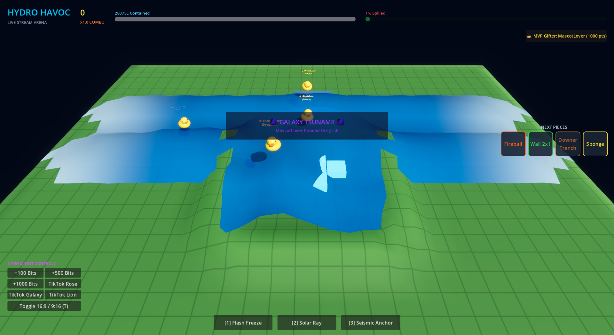

# HydroHavoc

A 2.5D water-puzzle game in the spirit of *Wetrix*, built in Godot 4.7 with a streamer audience in mind: viewers drop water and props into the arena you are trying to keep above sea level.

**Status: prototype.** The simulation, placement rules, scoring on evaporation, four floating prop classes and a mock audience-event dock are in place. There is no round structure, no win/lose condition, and no live platform connection yet. See [What works](#what-works) and [What is not built yet](#what-is-not-built-yet) before assuming any feature exists.



*The screenshot is from the first playable build; art is procedural placeholder geometry.*

---

## What works

- **Water simulation** — a 32x32 heightfield stepped at a fixed 30 Hz with explicit flux advection (`scripts/core/fluid_sim.gd`). Water flows downhill, drains over the arena rim, and total spilled volume is accumulated separately from what is still on the field.
- **Placement** — a rotating polyomino queue with six piece kinds: wall (upper), trench (downer), water drop, fireball, bomb and sponge (`scripts/core/piece_manager.gd`). 11 shape templates, 4 pieces visible in the queue.
- **Abilities on `1` / `2` / `3`** — Flash Freeze (10 s cooldown), Solar Ray (4 s), Seismic Anchor (12 s). Each is gated by its own cooldown and the HUD buttons show the remaining seconds and disable themselves (`scripts/core/game_manager.gd`, `scripts/ui/game_hud.gd`).
- **Scoring** — only evaporation scores. Boiling standing water with a fireball, Solar Ray or sponge raises a multiplier; the multiplier decays back to 1x after 5 s without a boil.
- **Spill pressure** — spilled volume fills the drain meter against a 35 L earthquake threshold. Crossing it shatters random wall cells, shakes the camera and resets the meter. It does not end the run.
- **Floating props** — four classes with distinct geometry: rubber duck, gift crate (`assets/models/props/gift_crate.glb`), heavy anchor and streamer mascot (`assets/models/characters/streamer_mascot.glb`). Each class is normalised to a target height between 1.35 m (crate) and 2.6 m (anchor) so it is identifiable at 720p from the default camera, with a donor nameplate above it. They are buoyant, drift with surface flow, tilt with the wave field, boil away for bonus points inside a steam radius and plunge if they reach the rim.
- **Mock audience dock** — HUD buttons inject Bits (100/500/1000) and TikTok gifts (Rose, Galaxy, Lion); `Tab` injects a random 100-Bit event. These call `StreamEventManager.simulate_*` directly. Nothing is read from a network socket yet.
- **Two camera/HUD arrangements** — `T` swaps the HUD into its portrait arrangement and pulls the camera back with a wider field of view (16:9 ↔ 9:16 framing).

## What is not built yet

- **No run loop.** There are no waves, rounds, timers, budget, or game over. The economy described in the product plan (rising water per wave, enclose → clear → score) does not exist.
- **No real platform integration.** No Twitch EventSub, TikTok Live, Kick or YouTube connection. `StreamEventManager` only holds mock helpers; a bridge process is planned but not started.
- **No menu, pause, settings, audio, or save.** One hand-built starting map.
- **No public build.** The Windows and Web presets exist (`export_presets.cfg`), but nothing is published and the Web export has never been verified in a browser by this project. The old GitHub Pages demo was a pre-Phase-0 export and has been withdrawn until the run loop exists.
- **Placeholder art throughout.** Procedural meshes and shaders; the gift crate has no texture; splash rings are opaque white torus meshes and the steam puff is an oversized sphere.
- **Known visual defects.** Water edges and foam read badly at the default camera; the gift crate GLB ships without a texture and renders as a blank box; the anchor sinks to the bed, so in water deeper than about 1.8 m only its crown shows.
- **Performance is unmeasured.** No frame-time or CPU budget has been recorded for either target.

## Controls

| Action | Input |
| :--- | :--- |
| Move placement cursor | `W` `A` `S` `D` or arrow keys |
| Rotate piece | `R` or `E` |
| Drop piece | `Space` or `Enter` |
| Toggle 16:9 / 9:16 framing | `T` or the HUD button |
| Ability 1 — Flash Freeze (10 s) | `1` |
| Ability 2 — Solar Ray (4 s) | `2` |
| Ability 3 — Seismic Anchor (12 s) | `3` |
| Inject a test donation | `Tab` (debug shortcut, see the mock dock in the HUD) |

## Donor names on screen

Viewer-supplied names reach prop nameplates, gift alerts and the VIP throne, so they pass through `scripts/core/name_policy.gd` first:

- Names are stripped of control characters, zero-width and bidi-override characters, and collapsed whitespace, then clamped to 16 characters (`...` when trimmed). A name cannot reflow a plate, add a second line, or visually reorder itself.
- A blocklist is matched after folding case, punctuation, spacing, leet substitutions (`0 1 3 4 5 7 8 @ $`) and repeated letters, so `n i g g 3 r` is caught like any other spelling.
- Anything that matches is replaced with `Viewer` rather than masked, and the name itself is not written to the log.

The blocklist lives in `user://name_blocklist.txt` (`%APPDATA%\Godot\app_userdata\HydroHavoc\name_blocklist.txt` on Windows). It is created with a default list on first run and is plain text, one entry per line: `*term*` matches anywhere in a name, a bare `term` matches only the whole name. Substring entries can catch innocent words, so switch an entry to a bare word if that matters. Edit the file and restart, or delete it to restore the defaults.

## Running it

1. Install Godot 4.7.x with the Forward+ renderer (the project was last booted on 4.7.2).
2. Open `project.godot` in the editor once so resources are imported, or run the import step below.
3. Run the project (`F5`), or from a shell:

```bash
godot --path .
```

### Checking the scripts

`tools/check.sh` imports the project, parses every script with a real Godot binary, then runs the tests: `tests/sim_invariants.gd` (a seeded, scripted run that asserts water mass conservation, no non-finite field values, no leaked or orphaned props, and that the fixed-step sim's catch-up cap holds under a frame spike), `tests/boot_test.gd`, `tests/name_policy_test.gd`, `tests/prop_size.gd` and `tests/float_height.gd`. A syntax error or a physics regression fails loudly instead of surfacing at runtime:

```bash
GODOT=/path/to/godot ./tools/check.sh
```

The last step is the rendered silhouette check, `tests/measure_props.gd`. It needs a real framebuffer, so the gate runs it when a display is available (Windows, or `DISPLAY`/`WAYLAND_DISPLAY` set) and prints `SKIP prop silhouettes: no display available` on headless CI, which stays green. On a desktop the pixels you actually ship are compared to the baseline every run; `MEASURE_PROPS=0` skips the step for a quick iteration and `MEASURE_PROPS=1` forces it.

## Project layout

```
scenes/main.tscn              Arena, camera rig, prop manager, HUD
scenes/ui/hud.tscn            Top bar, score, queue, ability buttons, mock dock
scripts/core/fluid_sim.gd     Heightfield water: flux advection, spill accounting, revision counter
scripts/core/game_manager.gd  Input, placement, scoring, abilities, hazards, quake
scripts/core/piece_manager.gd Piece templates, weighted queue, rotation
scripts/core/stream_event_manager.gd  Mock audience event hub (no network)
scripts/core/name_policy.gd   Donor-name clamp and blocklist for on-screen names
scripts/core/terrain_mesh_builder.gd  Terrain surface mesh
scripts/core/water_mesh_builder.gd    Water surface mesh
scripts/props/prop_manager.gd Spawning, splash waves, steam vaporisation
scripts/props/floating_prop.gd Buoyancy, drift, tilt, nameplate
scripts/ui/game_hud.gd        Meter/queue/cooldown updates, alerts
assets/shaders/               Terrain and water shaders
tools/check.sh                Import, parse and test gate used locally and in CI
```

## Verification status

Last checked on 2026-11-24 with Godot 4.7.2:

- `--headless --import` completed and all 12 scripts passed `--check-only`.
- Prop sizes are part of the gate: `tests/prop_size.gd` runs headless and compares each class's target height, fitted scale, seating and 720p projected extent against `tests/prop_size_baseline.json`, so a sizing change fails CI without a window.
- Boot, input and HUD are part of the gate: `tests/boot_test.gd` presses `ability_1`/`ability_2`/`ability_3` through the real `InputMap` and asserts each starts its cooldown (10/4/12 s), greys its HUD button and refuses to re-fire while cooling, then re-arms at zero; it lays the HUD out in a 1920x1080 SubViewport and asserts the water and drain meters clear the score box, and walks every runtime string for non-ASCII text.
- Float height is part of the gate too: `tests/float_height.gd` pins each class's submerge fraction, y offset and the resulting draft (`SUBMERGE_FRACTION * height - offset`: duck 0.33 m, crate 0.088 m, anchor 0.21 m, mascot 0.21 m), then settles each prop into a real 2 m basin of a real `FluidSim` through its own `_process` and checks the geometry lands there — including the anchor's bed clearance, which is the rule that actually runs in deep water.
- Rendered silhouettes are pinned separately in `tests/prop_silhouette_720p.json` (duck 59x55, crate 41x57, anchor 74x85, mascot 78x95 px, nameplate line 26 px; the keyed captures hide the water, so each silhouette is the prop's own pixels rather than what the waterline happens to leave showing). `tests/measure_props.gd` reproduces them to the pixel — it seeds the world, waits for the frame to stop changing, and four consecutive runs measured 0.0% drift — and it is the gate's last step wherever a display exists; headless runs skip it with a message instead of failing. The baseline also records the engine build, renderer, GPU and MSAA level that produced it. Pixel numbers are asserted only where a run matches that environment; anywhere else the harness prints a `SOFT COMPARISON` header listing every field that differs and reports `SOFT-PASS`/`SOFT-DIFF` without failing, so another GPU or a driver update cannot present itself as a prop-size regression.
- A scripted windowed boot of `scenes/main.tscn` ran 37 assertions with 0 failures: all four prop classes spawned with distinct geometry, the top-bar meters were measured clear of the score box, abilities `1`/`2`/`3` bound to the expected keycodes and applied their cooldowns, and no non-ASCII text was left in runtime strings.

Not verified: performance, the web export, the 9:16 layout on a portrait canvas, and any real platform API.

## Repo notes

- No export is committed. `export_presets.cfg` writes to `build/`, which is gitignored; publishing a demo again means exporting and committing the result deliberately.
- CI (`.github/workflows/ci.yml`) pins Godot 4.7.2 and runs `tools/check.sh`. Bump `GODOT_VERSION` in the workflow when the engine is upgraded. The workflow has not been run yet.
- Licence: MIT, see [LICENSE](LICENSE). Changes are listed in [CHANGELOG.md](CHANGELOG.md).
